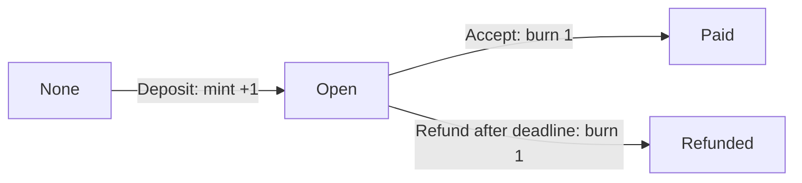
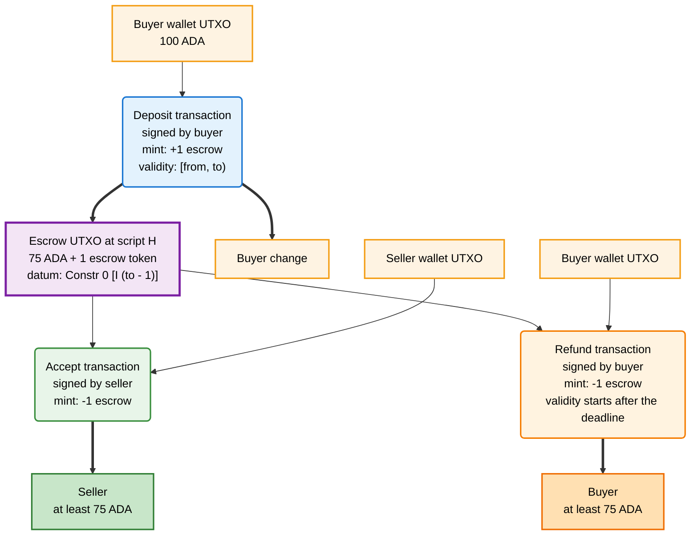

# Two-Party Escrow Benchmark Scenario

## Overview

The Two-Party Escrow benchmark is a **real-world smart contract scenario**. A buyer locks 75 ADA for a seller. The seller can take the payment for as long as it is locked. Thirty minutes after the deposit the buyer can take the money back.

One script serves two purposes. As a **minting policy** it creates and destroys a _thread token_: a marker that an escrow UTXO was created under the rules of the script. As a **spending validator** it guards the locked funds. The scenario measures how a compiler handles the dispatch on purpose and redeemer, lookups in values and in the mint field, signature and time checks, and the construction of a datum.

## TL;DR

Implement one Plutus V3 script that validates the deposit, the accept and the refund of the escrow, and compile it as a fully-applied UPLC program.

**Required Files**: Submit `two_party_escrow.uplc`, `metadata.json`, `metrics.json` to `submissions/two_party_escrow/{Compiler}_{Version}_{Handle}/`

**Target**: the five script executions of the escrow lifecycle → Expected result: `() (unit)`  
**Metrics**: CPU units, Memory units, Script size (bytes), Term size  
**Constraints**: Plutus Core 1.1.0, Plutus V3, CEK machine budget limits  
**Implementation**: one script of type `BuiltinData -> BuiltinUnit` with a minting and a spending purpose

## Exact Task

Implement the escrow as **one script** and compile it as a **fully-applied UPLC program** of type `BuiltinData -> BuiltinUnit`. Its one argument is the Plutus V3 `ScriptContext`. The script returns unit when the rules of this document hold, and fails in every other case.

### Fixed Parameters

These values are baked into the UPLC program:

| Parameter | Value |
| --- | --- |
| Buyer key hash | `aaaaaaaaaaaaaaaaaaaaaaaaaaaaaaaaaaaaaaaaaaaaaaaaaaaaaaaa` (28 bytes) |
| Seller key hash | `bbbbbbbbbbbbbbbbbbbbbbbbbbbbbbbbbbbbbbbbbbbbbbbbbbbbbbbb` (28 bytes) |
| Price | 75 ADA (`75000000` lovelace) |
| Refund delay | 30 minutes (`1800000`: `POSIXTime` counts milliseconds) |
| Token name | `escrow` (bytes `657363726f77`) |

The hash of the script is **not** a parameter. A program cannot contain its own hash, because the hash is computed from the program. The script reads the hash from the context instead: under the minting purpose it is the policy id, and under the spending purpose it is the script hash in the address of the input that the script spends. This document calls that hash `H`.

### Purposes and Redeemers

The redeemer is a Plutus Data integer. The purpose and the redeemer together select the action:

| Purpose | Redeemer | Action |
| --- | --- | --- |
| Minting | `0` | **Deposit**: the buyer mints the thread token into a new escrow UTXO |
| Minting | `1` or `2` | **Burn**: the thread token is destroyed, in the transaction that accepts or refunds |
| Spending | `1` | **Accept**: the seller takes the payment |
| Spending | `2` | **Refund**: the buyer takes the money back after the deadline |

Every other combination fails. A deposit transaction runs the script once. An accept or a refund transaction runs it twice: once for the escrow input and once for the burn.

### Datum Encoding

The escrow UTXO carries an inline datum with one field:

```text
EscrowDatum = Constr 0 [I depositTime]
```

`depositTime` is the last millisecond at which the deposit transaction was valid. The datum has no state field: the escrow UTXO exists while the deposit is open, and the accept or the refund consumes it.

### Thread Token

The policy id of the thread token is `H`, the hash of the script itself, and its name is `escrow`. Deposit mints one token into the escrow UTXO. Accept and Refund burn it. A UTXO at the script address is an escrow only if it holds the token: anybody can send ADA with any datum to the script address, but only Deposit can put the token there.

## View 1: State Lifecycle View



| Current State | Action  | Script runs                    | Next State   |
| ------------- | ------- | ------------------------------ | ------------ |
| **None**      | Deposit | Minting `0`                    | **Open**     |
| **Open**      | Accept  | Spending `1`, Minting `1 or 2` | **Paid**     |
| **Open**      | Refund  | Spending `2`, Minting `1 or 2` | **Refunded** |

- **None**: no escrow UTXO exists.
- **Open**: an escrow UTXO with 75 ADA, the thread token and the datum sits at the script address.
- **Paid**, **Refunded**: the escrow UTXO is spent and the token is burned. Both states are final.

## View 2: Transaction Sequence View



Accept and Refund are two alternative endings of one deposit. Each of them spends the escrow UTXO and a wallet UTXO that pays the fee.

## Validation Rules

Each rule has a name. The tests refer to the rules by these names.

Three terms are used throughout:

- The **payment credential** of an address is its first component: a key hash or a script hash. Every rule that looks at an address compares the payment credential only. The staking credential of an address is never restricted.
- The **own-policy mint entry** is what the mint field of the transaction holds for the policy `H`: token names with quantities.
- A rule that says **exactly** leaves no room: `{escrow: 1}` means one token name with quantity 1 and no other token name.

### Deposit (Minting, redeemer `0`)

`H` is the policy id of the minting purpose.

| Rule | Requirement |
| --- | --- |
| **D1** | The buyer's key hash is among the signatories of the transaction. |
| **D2** | The upper bound of the validity range is finite: `Finite t`. Then `depositTime = t - 1`. |
| **D3** | The own-policy mint entry is exactly `{escrow: 1}`. |
| **D4** | Exactly one output of the transaction has the payment credential `ScriptCredential H`. All outputs count, whatever their staking credential. |
| **D5** | That output holds exactly `75000000` lovelace. |
| **D6** | That output holds quantity 1 of the token `(H, escrow)`. |
| **D7** | That output has an inline datum, and the datum is the Data value `Constr 0 [I depositTime]`: no other constructor, no other field. An output with a datum hash or with no datum fails. |

Deposit does not restrict the inputs, the other outputs, the mint entries of other policies, or the other assets, the reference script and the staking credential of the escrow output.

### Burn (Minting, redeemer `1` or `2`)

| Rule   | Requirement                                          |
| ------ | ---------------------------------------------------- |
| **B1** | The own-policy mint entry is exactly `{escrow: -1}`. |

Both redeemers have the same rule. Burn does not repeat the rules of Accept and Refund: in the same transaction the ledger also runs the script for the escrow input.

### Accept and Refund: shared rules (Spending)

| Rule | Requirement |
| --- | --- |
| **S1** | The script finds its own input: the input whose reference equals the reference of the spending purpose. `H` is the script hash in its payment credential. |
| **S2** | Exactly one input of the transaction has the payment credential `ScriptCredential H`. All inputs count, whatever their staking credential and whatever they hold. Reference inputs do not count. |
| **S3** | The mint field holds quantity -1 of the token `(H, escrow)`. |

### Accept (Spending, redeemer `1`)

| Rule | Requirement |
| --- | --- |
| **A1** | The seller's key hash is among the signatories. |
| **A2** | The outputs whose payment credential is the seller's key hash hold at least `75000000` lovelace in total. |

Accept has no time rule: the seller can accept for as long as the escrow UTXO exists.

### Refund (Spending, redeemer `2`)

| Rule | Requirement |
| --- | --- |
| **R1** | The buyer's key hash is among the signatories. |
| **R2** | The lower bound of the validity range is finite, `Finite l`, and `l > depositTime + 1800000`. `depositTime` is the field of the datum that the spending purpose carries, which is the inline datum of the own input. |
| **R3** | The outputs whose payment credential is the buyer's key hash hold at least `75000000` lovelace in total. |

### Everything else

| Rule | Requirement |
| --- | --- |
| **X1** | Under the minting and the spending purpose every redeemer that the table of actions does not list fails. This includes redeemer `0` under Spending and every redeemer that is not an integer. |
| **X2** | Every other purpose fails. |
| **X3** | The script may assume that its argument is a V3 `ScriptContext` as the ledger builds it. It does not have to validate the shape of the context. The suite passes one other argument, the integer 0, and that run must fail. |

### Why these rules are enough

**The script does not check that its own input holds the token.** S3 demands a burn, and the ledger conserves value, so the burned token comes from an input. Tokens exist only in escrow outputs: Deposit mints exactly one (D3) into the one output at `H` (D4, D6), and a transaction cannot deposit and spend an escrow at once, because D3 and S3 read the same mint entry and disagree. S2 allows one input at `H`, so the burned token comes from the script's own input. A UTXO that somebody sent to the script address without a deposit holds no token and can never be spent: nothing can be burned for it.

**One escrow per transaction.** S2 rules out a transaction that spends two escrow UTXOs and pays once.

**The payment is a sum.** A2 and R3 add up all outputs of the receiver. The receiver signs the transaction and pays its fee, so the payment and the change of the receiver's wallet can sit in one output or in several.

**Value left at the script is not restricted.** After the burn, an output at the script address is outside the protocol. Like any UTXO at `H` without a token, it can never be spent.

**Time.** The ledger turns a validity interval into `txInfoValidRange` in one way only (`transValidityInterval` in cardano-ledger): a finite lower bound is inclusive, `LowerBound (Finite l) True`, and a finite upper bound is exclusive, `UpperBound (Finite t) False`. A script does not need to read the closure flags. Slots are one second long, so `l` and `t` are multiples of 1000 and `depositTime = t - 1` ends in 999. R2 is strict, so the first lower bound that passes is `t + 1800000`: the seller has 30 full minutes after the last moment at which the deposit could enter the chain. Deposit rejects an infinite upper bound, and Refund rejects an infinite lower bound.

### Implementation Freedom

The order of the checks, the way the context is decoded and every optimization are up to the implementation. The observable behaviour is fixed: every test of the suite must give the expected result. Two places leave room on purpose:

- S3 names one quantity. Whether the spending purpose also rejects other token names in the own-policy mint entry is not tested: B1 rejects them in the same transaction.
- D6 names one quantity for the same reason: D3 already rules out other token names of the policy.
- Refund reads a datum that Deposit wrote, so its shape is known (D7). What Refund does with a datum of another shape is not tested.
- The ledger builds the context, so its shape is known too. What the script does with a context of another shape, for example another outer constructor or an extra field, is not tested: a shape guard costs budget in every run and protects nothing on chain.

## Test Fixtures

`cape-tests.json` holds the tests. `test/Cape/TwoPartyEscrowFixturesSpec.hs` holds the rule tables above as a plain Haskell function and checks every test against it. It also lists conditions that the rules do not demand, such as "no staking credential on the escrow output", and checks that a successful test breaks each one: a validator that demands more than the rules fails the suite.

### Values

| Value | In the fixtures |
| --- | --- |
| Script hash `H` | `79b6440c81175f9417e9cc32203d2af3bb7c453854452f9f668ce1dd` in most tests, `9e9aea4c5ef25dfe52a1f5b46be13202475a7933adecdddf192ffb42` in the `*_other_hash` tests |
| Deposit validity range | `[1767225600000, 1767226200000)`, that is 2026-01-01 00:00 to 00:10 UTC |
| `depositTime` | `1767226199999` |
| Deadline | `1767227999999` |
| First valid refund bound | `1767228000000` |
| Third party ("impostor") | key hash `df0d3d5541f94352eeca5c4fde3a6c93839db2c4775a8b8b4203a9c0` |

The lifecycle runs under two script hashes. A validator that compares against a constant instead of reading `H` from the context fails under at least one of them.

### Shape of the contexts

Every context has the shape that the ledger gives a transaction:

- Key hashes, script hashes and policy ids are 28 bytes long. Transaction ids are 32 bytes long.
- Inputs are in ledger order, by transaction id and then by index. Signatories are in ascending order.
- Values and the mint field are sorted, and the mint field has no ADA entry.
- Value is conserved: inputs plus mint equal outputs plus fee, for ADA and for every asset. The fee is not zero, and every output holds at least 1 ADA.
- The spending purpose refers to an input of the transaction, and its datum is the inline datum of that input.
- `txInfoRedeemers` has one entry for every run of the escrow script: one for each input at `H`, then one for the policy `H` if the transaction mints or burns under it.
- Finite bounds of the validity range are multiples of 1000.
- A successful Accept or Refund has a wallet input and a change output next to the escrow input and the payment.

A rejected test is a successful transaction with one change, and its description names the rule that the change breaks, for example `(rule D4)`. Where one change breaks several rules, the description names all of them, and the script may fail on any of them.

The burn tests run on the transaction of the matching spending test: `accept_burn` evaluates the transaction of `accept_successful` under the minting purpose.

A test expects a result from one run of the script, not from the transaction. `accept_without_seller_signature` fails under the spending purpose. The minting purpose of that transaction would pass, and the ledger would still reject the transaction.

### Limits

These tests are synthetic, each in one declared way:

- `refund_at_exact_deadline` starts its validity range at `depositTime + 1800000`, which is not a multiple of 1000. It pins the strict comparison of R2.
- The three `rewarding_purpose_redeemer_*` tests switch the purpose to rewarding and leave the withdrawals and the redeemers of the transaction as they are.
- `not_a_script_context` passes the integer 0 instead of a context.

The test format cannot express some shapes, so they are not tested:

- An output with a datum hash instead of an inline datum.
- Withdrawals, certificates, votes, proposals and reference inputs: these fields are empty in every context.
- Redeemers of other scripts. Where a test has an input or a policy of another script, that script counts as a native script, which has no redeemer.

The suite proves behaviour on the CEK machine and the shape of the contexts. It does not submit transactions to a ledger.

## Test Cases

The table lists every test with the purpose and redeemer it runs under, the expected result and the rule it breaks. `cape-tests.json` has a description for each test.

| Test | Purpose, redeemer | Expected | Rule |
| --- | --- | --- | --- |
| `deposit_successful` | Minting, 0 | unit | - |
| `deposit_without_buyer_signature` | Minting, 0 | error | D1 |
| `deposit_signed_by_seller_only` | Minting, 0 | error | D1 |
| `deposit_with_second_signature` | Minting, 0 | unit | - |
| `deposit_infinite_upper_bound` | Minting, 0 | error | D2 |
| `deposit_infinite_lower_bound` | Minting, 0 | unit | - |
| `deposit_mints_two_tokens` | Minting, 0 | error | D3 |
| `deposit_mints_second_token_name` | Minting, 0 | error | D3 |
| `deposit_mints_wrong_token_name` | Minting, 0 | error | D3, D6 |
| `deposit_with_unrelated_mint` | Minting, 0 | unit | - |
| `deposit_to_pubkey_address` | Minting, 0 | error | D4 |
| `deposit_to_other_script` | Minting, 0 | error | D4 |
| `deposit_with_second_script_output` | Minting, 0 | error | D4 |
| `deposit_with_second_script_output_staked` | Minting, 0 | error | D4 |
| `deposit_split_across_script_outputs` | Minting, 0 | error | D4 |
| `deposit_one_lovelace_short` | Minting, 0 | error | D5 |
| `deposit_one_lovelace_over` | Minting, 0 | error | D5 |
| `deposit_token_to_buyer` | Minting, 0 | error | D6 |
| `deposit_without_datum` | Minting, 0 | error | D7 |
| `deposit_datum_records_upper_bound` | Minting, 0 | error | D7 |
| `deposit_datum_one_millisecond_early` | Minting, 0 | error | D7 |
| `deposit_datum_records_lower_bound` | Minting, 0 | error | D7 |
| `deposit_datum_with_extra_field` | Minting, 0 | error | D7 |
| `deposit_datum_with_state_field` | Minting, 0 | error | D7 |
| `deposit_datum_wrong_constructor` | Minting, 0 | error | D7 |
| `deposit_datum_bare_integer` | Minting, 0 | error | D7 |
| `deposit_change_before_escrow_output` | Minting, 0 | unit | - |
| `deposit_to_staked_script_address` | Minting, 0 | unit | - |
| `deposit_with_reference_script` | Minting, 0 | unit | - |
| `deposit_with_output_to_unrelated_script` | Minting, 0 | unit | - |
| `deposit_with_unrelated_script_input` | Minting, 0 | unit | - |
| `deposit_with_foreign_assets` | Minting, 0 | unit | - |
| `accept_successful` | Spending, 1 | unit | - |
| `accept_burn` | Minting, 1 | unit | - |
| `refund_successful` | Spending, 2 | unit | - |
| `refund_burn` | Minting, 2 | unit | - |
| `accept_without_seller_signature` | Spending, 1 | error | A1 |
| `accept_signed_by_buyer_only` | Spending, 1 | error | A1 |
| `accept_one_lovelace_short` | Spending, 1 | error | A2 |
| `accept_exact_payment` | Spending, 1 | unit | - |
| `accept_payment_to_impostor` | Spending, 1 | error | A2 |
| `accept_payment_to_buyer` | Spending, 1 | error | A2 |
| `accept_payment_in_one_output` | Spending, 1 | unit | - |
| `accept_payment_split` | Spending, 1 | unit | - |
| `accept_payment_to_staked_address` | Spending, 1 | unit | - |
| `accept_payment_with_datum` | Spending, 1 | unit | - |
| `accept_payment_with_reference_script` | Spending, 1 | unit | - |
| `accept_leftover_at_script` | Spending, 1 | unit | - |
| `accept_two_escrow_inputs` | Spending, 1 | error | S2 |
| `accept_two_escrow_inputs_one_staked` | Spending, 1 | error | S2 |
| `accept_two_escrow_inputs_burn_both` | Spending, 1 | error | S2, S3 |
| `accept_with_tokenless_script_input` | Spending, 1 | error | S2 |
| `accept_with_unrelated_script_input` | Spending, 1 | unit | - |
| `accept_without_burn` | Spending, 1 | error | S3 |
| `accept_with_mint_instead_of_burn` | Spending, 1 | error | S3 |
| `accept_burns_token_of_other_policy` | Spending, 1 | error | S3 |
| `accept_with_unrelated_mint` | Spending, 1 | unit | - |
| `accept_escrow_at_staked_address` | Spending, 1 | unit | - |
| `accept_escrow_with_reference_script` | Spending, 1 | unit | - |
| `accept_escrow_with_foreign_assets` | Spending, 1 | unit | - |
| `accept_with_second_signature` | Spending, 1 | unit | - |
| `accept_escrow_input_first` | Spending, 1 | unit | - |
| `refund_without_buyer_signature` | Spending, 2 | error | R1 |
| `refund_signed_by_seller_only` | Spending, 2 | error | R1 |
| `refund_one_lovelace_short` | Spending, 2 | error | R3 |
| `refund_exact_payment` | Spending, 2 | unit | - |
| `refund_payment_to_impostor` | Spending, 2 | error | R3 |
| `refund_payment_to_seller` | Spending, 2 | error | R3 |
| `refund_payment_in_one_output` | Spending, 2 | unit | - |
| `refund_payment_split` | Spending, 2 | unit | - |
| `refund_payment_to_staked_address` | Spending, 2 | unit | - |
| `refund_payment_with_datum` | Spending, 2 | unit | - |
| `refund_payment_with_reference_script` | Spending, 2 | unit | - |
| `refund_leftover_at_script` | Spending, 2 | unit | - |
| `refund_two_escrow_inputs` | Spending, 2 | error | S2 |
| `refund_two_escrow_inputs_one_staked` | Spending, 2 | error | S2 |
| `refund_two_escrow_inputs_burn_both` | Spending, 2 | error | S2, S3 |
| `refund_with_tokenless_script_input` | Spending, 2 | error | S2 |
| `refund_with_unrelated_script_input` | Spending, 2 | unit | - |
| `refund_without_burn` | Spending, 2 | error | S3 |
| `refund_with_mint_instead_of_burn` | Spending, 2 | error | S3 |
| `refund_burns_token_of_other_policy` | Spending, 2 | error | S3 |
| `refund_with_unrelated_mint` | Spending, 2 | unit | - |
| `refund_escrow_at_staked_address` | Spending, 2 | unit | - |
| `refund_escrow_with_reference_script` | Spending, 2 | unit | - |
| `refund_escrow_with_foreign_assets` | Spending, 2 | unit | - |
| `refund_with_second_signature` | Spending, 2 | unit | - |
| `refund_escrow_input_last` | Spending, 2 | unit | - |
| `accept_after_refund_deadline` | Spending, 1 | unit | - |
| `accept_without_validity_range` | Spending, 1 | unit | - |
| `refund_one_slot_before_deadline` | Spending, 2 | error | R2 |
| `refund_at_first_valid_slot` | Spending, 2 | unit | - |
| `refund_at_exact_deadline` | Spending, 2 | error | R2 |
| `refund_right_after_deposit` | Spending, 2 | error | R2 |
| `refund_infinite_lower_bound` | Spending, 2 | error | R2 |
| `refund_infinite_upper_bound` | Spending, 2 | unit | - |
| `refund_forged_utxo_without_token` | Spending, 2 | error | S3 |
| `accept_burn_with_other_burn_redeemer` | Minting, 2 | unit | - |
| `accept_with_other_burn_redeemer` | Spending, 1 | unit | - |
| `accept_burn_two_tokens` | Minting, 1 | error | B1 |
| `accept_burn_with_second_token_name` | Minting, 1 | error | B1 |
| `accept_burn_with_second_signature` | Minting, 1 | unit | - |
| `accept_burn_with_unrelated_mint` | Minting, 1 | unit | - |
| `burn_redeemer_1_on_deposit` | Minting, 1 | error | B1 |
| `refund_burn_with_other_burn_redeemer` | Minting, 1 | unit | - |
| `refund_with_other_burn_redeemer` | Spending, 2 | unit | - |
| `refund_burn_two_tokens` | Minting, 2 | error | B1 |
| `refund_burn_with_second_token_name` | Minting, 2 | error | B1 |
| `refund_burn_with_second_signature` | Minting, 2 | unit | - |
| `refund_burn_with_unrelated_mint` | Minting, 2 | unit | - |
| `burn_redeemer_2_on_deposit` | Minting, 2 | error | B1 |
| `deposit_redeemer_on_burn` | Minting, 0 | error | D1, D3, D4 |
| `deposit_successful_other_hash` | Minting, 0 | unit | - |
| `accept_successful_other_hash` | Spending, 1 | unit | - |
| `accept_burn_other_hash` | Minting, 1 | unit | - |
| `refund_successful_other_hash` | Spending, 2 | unit | - |
| `refund_burn_other_hash` | Minting, 2 | unit | - |
| `spending_with_deposit_redeemer` | Spending, 0 | error | X1 |
| `spending_redeemer_integer_3` | Spending, I 3 | error | X1 |
| `minting_redeemer_integer_3` | Minting, I 3 | error | X1 |
| `spending_redeemer_integer_negative_1` | Spending, I -1 | error | X1 |
| `minting_redeemer_integer_negative_1` | Minting, I -1 | error | X1 |
| `spending_redeemer_constructor_0` | Spending, Constr 0 [] | error | X1 |
| `minting_redeemer_constructor_0` | Minting, Constr 0 [] | error | X1 |
| `spending_redeemer_constructor_1` | Spending, Constr 1 [] | error | X1 |
| `minting_redeemer_constructor_1` | Minting, Constr 1 [] | error | X1 |
| `spending_redeemer_bytestring` | Spending, B #01 | error | X1 |
| `minting_redeemer_bytestring` | Minting, B #01 | error | X1 |
| `spending_redeemer_list` | Spending, List [I 1] | error | X1 |
| `minting_redeemer_list` | Minting, List [I 1] | error | X1 |
| `spending_redeemer_map` | Spending, Map [(I 1, I 1)] | error | X1 |
| `minting_redeemer_map` | Minting, Map [(I 1, I 1)] | error | X1 |
| `rewarding_purpose_redeemer_0` | Rewarding, 0 | error | X2 |
| `rewarding_purpose_redeemer_1` | Rewarding, 1 | error | X2 |
| `rewarding_purpose_redeemer_2` | Rewarding, 2 | error | X2 |
| `not_a_script_context` | - | error | X3 |

## Measurement Guidelines

### Measured executions

The aggregated metrics cover the five script executions of the lifecycle. These are the `measurements` of `cape-tests.json`:

| Measurement          | Purpose, redeemer | Transaction |
| -------------------- | ----------------- | ----------- |
| `deposit_successful` | Minting, 0        | Deposit     |
| `accept_successful`  | Spending, 1       | Accept      |
| `accept_burn`        | Minting, 1        | Accept      |
| `refund_successful`  | Spending, 2       | Refund      |
| `refund_burn`        | Minting, 2        | Refund      |

The sum is the cost of one deposit and of both endings. An accept transaction pays for `accept_successful` and `accept_burn` together, a refund transaction for `refund_successful` and `refund_burn`.

All other tests are `checks`. A check verifies correctness: its budget is recorded in `metrics.json` under `evaluations`, and it does not feed the aggregates. This holds for the rejected transactions and also for the successful variants of a transaction shape, such as a payment split over two outputs. See [ADR: exclude failure-path evaluations from aggregated metrics](../../doc/adr/20260706-exclude-failure-path-evaluations-from-aggregated-metrics.md).

### Required Metrics

1. **CPU Units** and **Memory Units**: sum, maximum, minimum and median over the five measurements
2. **Script Size**: size of the compiled script in bytes
3. **Term Size**: number of AST nodes of the UPLC term

`cape submission measure` produces `metrics.json` in the format of `submissions/TEMPLATE/metrics.schema.json`. [`doc/metrics.md`](../../doc/metrics.md) defines each metric.
